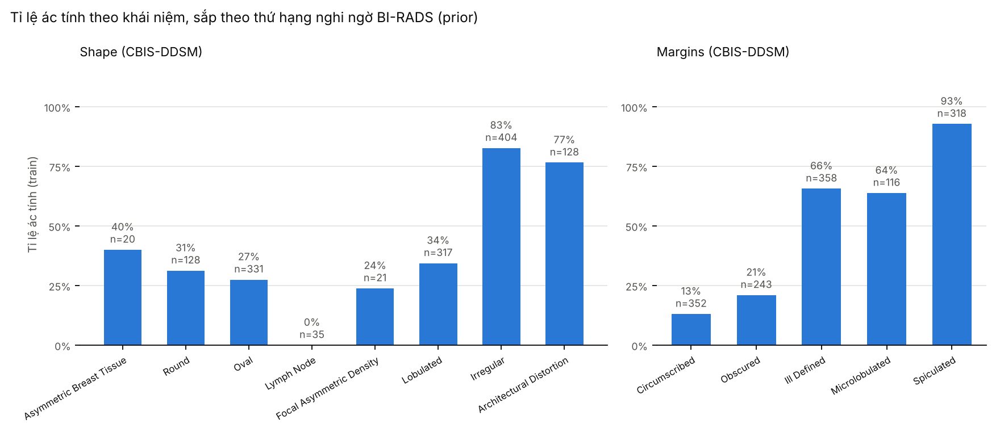
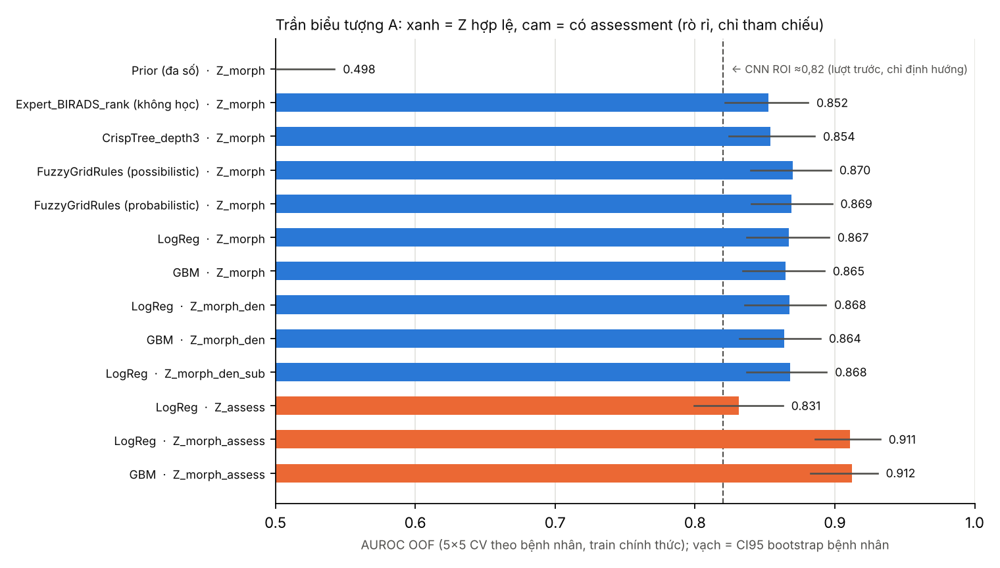
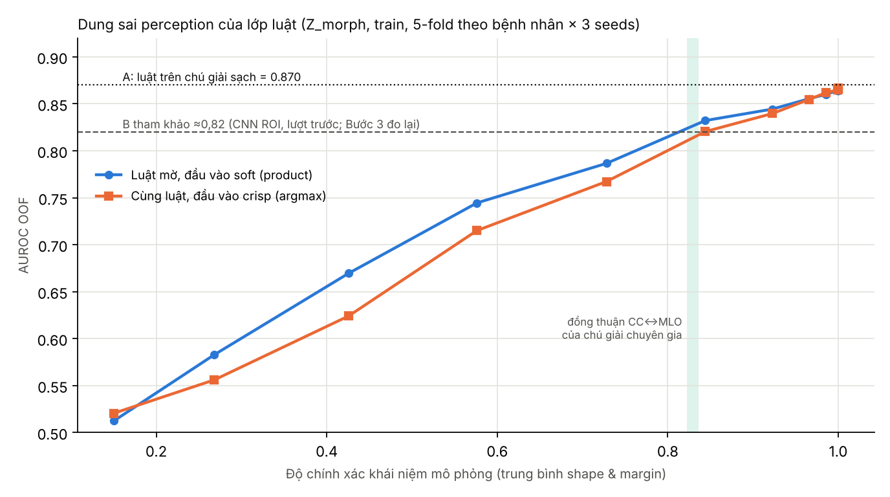

# 02 — Bước 1: làm lại từ đâu, phân tích chi tiết và kết quả đã chạy

Ngày chạy: 28/10/2026. Mã: `step1/`. Đầu vào: 4 CSV chính thức của CBIS-DDSM. Số dòng khớp bản phát hành (mass 1318/378, calc 1546/326); SHA-256 ghi trong `step1/results/1a_audit/audit_summary.json`. Mọi mô hình hóa chỉ dùng **train chính thức** (1.318 dòng, 691 bệnh nhân), CV 5-fold theo bệnh nhân, lặp 5 seed. Official test chỉ được đếm số dòng, không mô hình hóa.

---

## 1. Trả lời ngắn: làm lại từ đâu?

**Không làm lại từ CNN, cũng không từ pipeline.** Điểm xuất phát đúng là câu hỏi tiền đề trong email của GS: *thuộc tính Z có chứa nhiều thông tin về Y hơn ảnh không, và lớp luật cần các khái niệm chính xác đến đâu?* Câu hỏi này trả lời được chỉ bằng CSV, trên CPU, trong vài phút.

Bước 1 gồm bốn việc:

| | Việc | Đầu ra |
|---|---|---|
| 1.0 | Định nghĩa lại bài toán: X, Z, Y, đơn vị phân tích, các trường bị loại | Bảng ở mục 2 |
| 1a | Audit dữ liệu từ CSV gốc; ánh xạ từ vựng sang **ontology BI-RADS v0**; đo nhiễu chú giải bằng đồng thuận CC↔MLO | `step1/ontology/`, `results/1a_audit/` |
| 1b | **Trần biểu tượng A:** Y dự đoán được bao nhiêu từ Z, bằng mô hình thống kê, luật crisp, luật mờ và tri thức thuần | `results/1b_symbolic_ceiling/` |
| 1c | **Dung sai perception:** AUROC của lớp luật theo độ chính xác khái niệm; so sánh nhiễu ngẫu nhiên với nhiễu kiểu con người | `results/1c_perception_tolerance/` |

---

## 2. Định nghĩa bài toán (khóa cho các bước sau)

| Mục | Quyết định | Lý do |
|---|---|---|
| Nhiệm vụ | Phân loại lành/ác tính của **mass đã được định vị** (ROI cho sẵn) | Đúng dữ liệu có Z; không gọi là phát hiện ung thư từ toàn phim |
| Đơn vị | Một dòng = một tổn thương trên một view. Các view và tổn thương của cùng bệnh nhân luôn cùng fold | Tránh rò rỉ giữa người |
| Y | MALIGNANT = 1; BENIGN và BENIGN_WITHOUT_CALLBACK = 0 | Phân tích độ nhạy khi bỏ BWC |
| Z chính (Z_morph) | mass shape và mass margins, đa trị, ánh xạ sang BI-RADS 5 | Nhìn thấy được trên tổn thương; có trong ontology |
| Z ngữ cảnh | breast density | Kiểm tra; không đưa vào Z chính nếu không có ích |
| Bị loại khỏi Z | **assessment** (rò rỉ), subtlety (mô tả người đọc), ID, đường dẫn | Mục 3.3 |
| Thước đo chính | AUROC; kèm accuracy ở ngưỡng 0,5, balanced accuracy, Brier | AUROC không phụ thuộc ngưỡng |
| Thống kê | CI 95% bootstrap theo bệnh nhân (2.000 lần) trên dự đoán OOF | Chuẩn cho dữ liệu nhóm |

---

## 3. Kết quả 1a — audit dữ liệu

### 3.1. Cohort

| Partition | Dòng (lesion-view) | Bệnh nhân | Ảnh | Tổn thương (giả định) | Có cả CC và MLO | Ác tính | BWC |
|---|---:|---:|---:|---:|---:|---:|---:|
| Train | 1.318 | 691 | 1.231 | 782 | 536 | 637 (48,3%) | 104 |
| Test (chỉ đếm) | 378 | 201 | 361 | 223 | 155 | 147 (38,9%) | 37 |

Không có bệnh nhân nào nằm ở cả train lẫn test chính thức. Khóa tổn thương được giả định là (bệnh nhân, bên vú, abnormality id). Giả định này được hỗ trợ bởi việc pathology khớp **99,6%** giữa hai view.

### 3.2. Từ vựng và ontology BI-RADS v0

File `step1/ontology/birads_mass_lexicon.json` ánh xạ 8 giá trị shape và 5 giá trị margin của CBIS sang BI-RADS 5th edition. File cũng ghi thứ bậc (MassShape, OtherFinding, SuspiciousMargin…), thứ hạng nghi ngờ (prior định tính, **không học từ dữ liệu**) và các trường bị loại.



Nhận xét:

- **Margin là trục chính:** circumscribed 13%, obscured 21%, ill-defined 66%, microlobulated 64%, spiculated 93% ác tính. Thứ tự gần như đơn điệu theo prior BI-RADS. Microlobulated và ill-defined có tỉ lệ ngang nhau, phù hợp với việc xếp cùng hạng.
- **Shape:** irregular 83%, architectural distortion 77%, còn round/oval/lobulated chỉ 27–34%. Lymph node 0/35.
- **Prior của ASYMMETRIC_BREAST_TISSUE (hạng 0) chưa khớp dữ liệu:** 40% ác tính, nhưng n = 20 rất nhỏ. Cần GS hoặc bác sĩ xem lại.
- **Ô đa trị:** 69 dòng shape và 106 dòng margin. **Thiếu:** 4 dòng shape, 43 dòng margin. **145 dòng** chỉ có "OtherFinding" (architectural distortion, asymmetry, lymph node), về mặt BI-RADS 5 không phải mass.

### 3.3. Assessment là rò rỉ: bằng chứng

| Assessment | Benign | BWC | Malignant |
|---|---:|---:|---:|
| 2 | 28 | 49 | **0** |
| 3 | 189 | 45 | 45 |
| 4 | 246 | 8 | 279 |
| 5 | 4 | 2 | **293** |

Assessment là kết luận chẩn đoán của bác sĩ, không phải thuộc tính quan sát. Đưa nó vào Z sẽ thổi phồng A thêm khoảng 0,04 AUROC (mục 4). Kết luận: **loại khỏi Z**, chỉ giữ làm tham chiếu.

### 3.4. Nhiễu chú giải: đồng thuận CC↔MLO trên cùng tổn thương (536 tổn thương)

| Trường | Đồng thuận |
|---|---:|
| Pathology | 99,6% |
| Density | 100% |
| Assessment | 95,2% |
| **Shape (đúng giá trị từ vựng)** | **82,3%** |
| **Margin (đúng giá trị từ vựng)** | **83,6%** |
| Shape theo mức nghi ngờ (thấp / cao) | 94,6% |
| Margin theo mức nghi ngờ (benign-appearing / indeterminate / suspicious) | 87,7% |
| Subtlety | 81,3% |

Ma trận nhầm lẫn (`cross_view_*_confusion.csv`) cho thấy bất đồng tập trung giữa các **khái niệm láng giềng**: ill-defined ↔ spiculated, lobulated ↔ oval, round ↔ oval. Hiếm khi có nhầm circumscribed ↔ spiculated.

**Hệ quả:** với các khái niệm này, trần độ chính xác khi dự đoán từ ảnh không phải 100% mà khoảng 82–84% theo từ vựng. Một thước đo như macro-F1 theo từ vựng sẽ đánh giá perception quá khắt khe.

---

## 4. Kết quả 1b — trần biểu tượng A



AUROC OOF, trung bình 5 lần lặp × 5-fold theo bệnh nhân; CI 95% bootstrap theo bệnh nhân (lần lặp 0).

| Mô hình trên Z | Học? | AUROC | CI 95% | Accuracy |
|---|---|---:|---|---:|
| Prior (đa số) | – | 0,498 | – | – |
| **Chỉ tri thức BI-RADS** (max hạng margin + max hạng shape) | **Không** | **0,853** | [0,822; 0,881] | – |
| Cây crisp sâu 3 | Có | 0,854 | [0,824; 0,886] | 80,8% |
| **Luật mờ lưới Shape×Margin** (possibilistic) | Có | **0,870** | [0,840; 0,897] | 80,6% |
| Luật mờ lưới (probabilistic) | Có | 0,869 | [0,840; 0,898] | 80,6% |
| Logistic regression | Có | 0,867 | [0,837; 0,896] | 79,7% |
| GBM | Có | 0,865 | [0,834; 0,893] | 80,1% |
| LR + density | Có | 0,868 | – | 79,8% |
| LR + density + subtlety | Có | 0,868 | – | 80,3% |
| *Rò rỉ:* LR chỉ assessment | Có | 0,831 | – | 75,0% |
| *Rò rỉ:* LR Z_morph + assessment | Có | 0,911 | [0,886; 0,933] | 83,2% |

Độ nhạy (luật mờ possibilistic): bỏ BWC cho AUROC 0,877; chỉ giữ mass thật theo BI-RADS 5 cho 0,873. Kết luận không đổi.

**Thông tin:** I(Y; shape×margin) giải thích **44%** entropy của Y (riêng margin 38%, riêng shape 21%). Có 65 ô shape×margin khác nhau. Phân loại theo đa số trong từng ô, tính in-sample nên lạc quan, chỉ đạt **82,5% accuracy**. Đây là trần accuracy thực tế của Z_morph.

### Điều quan trọng rút ra

1. **A ≈ 0,87 AUROC, khoảng 81% accuracy** với Z hợp lệ. Density và subtlety không thêm gì.
2. **Lớp luật không phải nút thắt.** Khác với Leaf, luật mờ lưới khoảng 34 luật (24 luật có support ≥ 10) **ngang hoặc nhỉnh hơn** LR và GBM. Khoảng cách G_rule ≈ 0.
3. **Chỉ riêng tri thức, không học, đã đạt 0,853**, tức gần 98% hiệu năng của mô hình học tốt nhất. Đây là luận cứ mạnh cho hướng ontology của GS: tri thức BI-RADS đã mã hóa phần lớn quan hệ Z → Y. Phần học từ dữ liệu chủ yếu tinh chỉnh các ô trung gian (ví dụ oval + ill-defined: 46%).
4. Ví dụ luật học được: IF Irregular AND Spiculated THEN ác tính 0,94 (support 228); IF Oval AND Circumscribed THEN ác tính 0,07 (support 133); IF Lymph node AND Circumscribed THEN ác tính 0,02.
5. **Ví dụ giải thích mờ** cho một mass "IRREGULAR / ILL_DEFINED-SPICULATED": hai luật kích hoạt, mỗi luật mức 1. Irregular ∧ Ill-defined (0,74) đóng góp 0,37; Irregular ∧ Spiculated (0,94) đóng góp 0,47. Kết quả p = 0,84. Dự đoán được phân rã chính xác thành đóng góp từng luật (`example_explanation.json`).

---

## 5. Kết quả 1c — dung sai perception



**Thí nghiệm mô phỏng.** Luật được học trên chú giải sạch. Ở fold test, đầu vào được thay bằng khái niệm "dự đoán" có độ chính xác điều khiển được, với nhiễu ngẫu nhiên đối xứng. Cùng một bộ luật được cho nhận đầu vào **soft** (giữ phân bố, suy luận mờ) hoặc **crisp** (argmax trước rồi mới suy luận).

| Độ chính xác khái niệm (TB shape & margin) | Luật mờ, soft | Cùng luật, crisp | Chênh lệch |
|---:|---:|---:|---:|
| 43% | 0,670 | 0,624 | +0,045 |
| 58% | 0,745 | 0,715 | +0,029 |
| 73% | 0,787 | 0,767 | +0,019 |
| 84% | 0,832 | 0,821 | +0,012 |
| 92% | 0,844 | 0,840 | +0,005 |
| ≥ 98% | 0,860–0,867 | 0,862–0,867 | ≈ 0 |

- Để chạm mốc tham khảo B ≈ 0,82 cần độ chính xác khái niệm khoảng **81% (soft)** hoặc **84% (crisp)** dưới nhiễu ngẫu nhiên. Mốc này đã sát trần đồng thuận con người (82–84%).
- **Suy luận mờ trên đầu vào soft luôn tốt hơn argmax ở vùng perception chưa hoàn hảo**, tới +0,045 AUROC. Đây là luận cứ định lượng đầu tiên cho việc giữ bất định khái niệm thay vì quyết định cứng. Lợi ích tiến về 0 khi khái niệm gần hoàn hảo. t-norm product tốt hơn min một chút.

**Thí nghiệm nhiễu kiểu con người.** Thay chú giải của mỗi view bằng chú giải của view kia trên cùng tổn thương (1.072 dòng; 294 dòng, tức 27%, bị thay đổi khái niệm):

| | AUROC (TB 5 seed, cùng 1.072 dòng) |
|---|---:|
| Chú giải của chính view đó | 0,879 |
| Chú giải của view kia (shape đổi 17,7%, margin đổi 16,4% số dòng) | **0,875** |
| Đối chứng: đổi **ngẫu nhiên** đúng cùng tỉ lệ dòng, sang giá trị khác theo tần suất train | **0,796** (từng seed 0,765–0,811) |

**Cùng một lượng thay đổi khái niệm, nhưng kiểu thay đổi của con người chỉ làm giảm 0,004 AUROC, còn kiểu ngẫu nhiên làm giảm 0,083.** Lý do: con người nhầm giữa các khái niệm **cùng mức nghi ngờ**. Đây là phát hiện quan trọng nhất của Bước 1 cho thiết kế mô hình:

> **Điều quyết định không phải perception đúng từ vựng, mà perception không vượt sai mức nghi ngờ.** Mô hình nhận thức khái niệm nên được huấn luyện và đánh giá theo cấu trúc ontology: phạt nặng nhầm circumscribed ↔ spiculated, phạt nhẹ nhầm ill-defined ↔ spiculated.

---

## 6. Kết luận Bước 1 và cổng quyết định

| Câu hỏi | Trả lời từ dữ liệu |
|---|---|
| Có Z hợp lệ, không rò rỉ không? | Có: Z_morph (shape + margin). Assessment bị loại; bằng chứng định lượng có. |
| A bằng bao nhiêu? | ≈ 0,87 AUROC, khoảng 81% accuracy. Trần accuracy của Z_morph khoảng 82%. |
| B << A không? | **Chưa chắc.** Với B tham khảo ≈ 0,82 (CNN ROI của lượt trước), A − B ≈ 0,05 AUROC: dương nhưng không "<<". Một CNN mạnh hơn có thể thu hẹp khoảng cách. B sẽ được đo công bằng ở Bước 3. |
| Lớp luật có phải nút thắt không? | **Không.** Luật mờ nhỏ ngang LR/GBM; tri thức thuần đạt 0,853. |
| Perception cần tốt đến đâu? | Khoảng 81% độ chính xác từ vựng dưới nhiễu ngẫu nhiên. Nhưng nếu sai số có cấu trúc như con người, yêu cầu thấp hơn nhiều. |

**Cổng 1: qua có điều kiện.** Tiền đề của GS (A > B) đúng hướng trên CBIS-DDSM nhưng biên hẹp. Hai đòn bẩy cho các bước sau, mỗi đòn có giả thuyết kiểm chứng được:

1. **Tăng A** bằng thuộc tính hình thái **liên tục** tính từ mask chuyên gia (Bước 2). Shape/margin phân loại là biểu diễn thô; độ tròn, độ đặc, chỉ số spiculation, độ sắc nét bờ có thể phân biệt bên trong các ô trung gian (oval + ill-defined, lobulated + microlobulated). Đây cũng chính là yêu cầu "categorical + continuous" của GS.
2. **Tăng R hiệu dụng** bằng perception nhận thức ontology và suy luận mờ trên đầu vào soft (Bước 6).

**Quyết định cho các bước sau:**

- Thước đo chính là AUROC.
- Z chính là Z_morph, sẽ mở rộng bằng thuộc tính liên tục.
- Loại assessment.
- Giữ BWC trong phân tích chính, có phân tích độ nhạy khi bỏ.
- Giữ cả OtherFinding trong phân tích chính, có độ nhạy "chỉ mass thật".

---

## 7. Đề nghị gửi GS (1 trang) và câu hỏi cần GS quyết định

**Tóm tắt có thể gửi:** Trên CBIS-DDSM mass (train chính thức, CV theo bệnh nhân), shape + margin cho A ≈ 0,87 AUROC. Tri thức BI-RADS thuần, không học, đạt 0,853. Một hệ khoảng 30 luật mờ đạt 0,870, ngang LR/GBM. Assessment là rò rỉ (+0,04). Chú giải chuyên gia giữa hai view của cùng tổn thương chỉ khớp khoảng 83% theo từ vựng, nhưng thay chú giải bằng view kia chỉ làm AUROC giảm 0,004. Đổi ngẫu nhiên cùng tỉ lệ thì giảm 0,083, vì bất đồng của con người nằm trong cùng mức nghi ngờ. Bước tiếp theo: thêm thuộc tính hình thái liên tục từ mask để mở rộng A, rồi đo B và độ khôi phục khái niệm từ ảnh.

**Câu hỏi cho GS:**

1. Xác nhận ontology v0: xử lý LOBULATED (BI-RADS 5 gộp vào Oval), thứ hạng nghi ngờ, và có giữ OtherFinding không.
2. Có muốn dùng PN-OWL hoặc fuzzyDL làm bộ học luật trên ontology ở Bước 5 không? Có cần đề nghị GS hỗ trợ công cụ không?
3. Claim chính ưu tiên: "vượt CNN" hay "không kém hơn + giải thích + can thiệp"? Biên non-inferiority (ví dụ 0,02 AUROC) nên khóa trước Bước 6.
4. Có cần miền thứ hai (calcification của CBIS-DDSM, hoặc audio) để chứng minh tính tổng quát không?

---

## 8. Giới hạn của Bước 1

- **Khóa tổn thương CC↔MLO** là giả định (bệnh nhân, bên vú, abnormality id); được hỗ trợ nhưng không được chứng minh tuyệt đối.
- **Mô phỏng perception** dùng nhiễu độc lập, đối xứng. Sai số thật của CNN có cấu trúc và tương quan giữa shape và margin. Đường cong là định hướng, không phải dự báo.
- **B ≈ 0,82** lấy từ một lượt phát triển trước, chỉ dùng để định hướng. Bước 3 sẽ đo lại công bằng trên cùng cohort.
- Mọi kết quả nằm trên train chính thức (691 bệnh nhân). CI rộng khoảng ±0,03.
- Luật mờ trên Z sạch gần như crisp vì phần lớn chú giải đơn trị. Lợi ích của mờ chỉ lộ ra khi đầu vào là khái niệm dự đoán (mục 5) hoặc thuộc tính liên tục (Bước 2).

---

## 9. Tái lập

**Cách khuyến nghị: Google Colab.** Mở `step1/Step1_CBIS_DDSM_Colab.ipynb` rồi chọn *Runtime → Run all*. Notebook tự chứa (không cần file .py), tự tải và kiểm tra SHA-256 của CSV, chạy khoảng 30 giây trên CPU, và tự sinh bảng tổng kết. Các con số khớp với bản `.py` (CI bootstrap có thể lệch ở chữ số thứ ba do khác chuỗi ngẫu nhiên).

Hoặc chạy bản `.py` trên máy:

```bash
cd claude_research/step1
python s1_audit.py
python s1_symbolic_ceiling.py     # khoảng 7 phút trên CPU (bootstrap)
python s1_perception_tolerance.py
```

Phụ thuộc: numpy, pandas, scikit-learn, matplotlib. Đã chạy với Python 3, scikit-learn 1.9.1, pandas 3.0.5.
